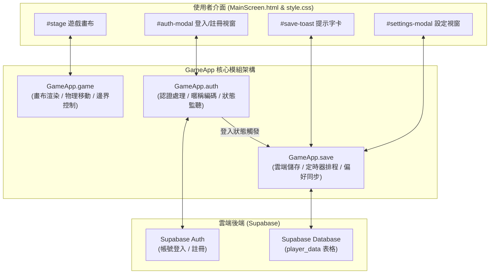

# 🎮 AI Game Project - 2D 畫布遊戲與雲端帳號同步系統

本專案是一個輕量、模組化且高度可維護的 HTML5 Canvas 2D 冒險遊戲核心系統。前端採用純原生 JavaScript (Vanilla JS) 與 CSS 變數設計系統，無任何繁重的構建工具或依賴，直接開啟即可運行；後端整合 **Supabase** 提供安全的帳號認證（Auth）與即時雲端進度同步（Database Upsert）。

---

## 🌟 核心功能特色

### 1. 🕹️ 流暢的 2D 畫布與角色控制 (`game.js`)
- **雙按鍵支援**：支援 `W / A / S / D` 與方向鍵 `↑ / ← / ↓ / →` 雙套操作。
- **按鍵狀態佇列（Set 結構）**：徹底解決傳統鍵盤放開時反向卡鍵、延遲走動或停頓的問題。
- **斜向等速正規化**：以 \(\frac{1}{\sqrt{2}}\) 向量校正斜走速度，避免斜向移動速度偏快的物理異常。
- **防鬼畜失焦保護**：當使用者開啟設定彈窗、按快捷鍵切換應用程式或視窗失焦（`blur`）時，自動重置按鍵與速度，避免角色無故持續奔跑。
- **動態頭像與備用向量繪圖**：支援自訂精靈圖檔（`amiya.jpg`），並具備腳底微陰影與圖檔載入失敗時的備用向量渲染。

### 2. 🔐 靈活的帳號認證系統 (`auth.js`)
- **任意字元遊戲暱稱支援**：Supabase Auth 原生僅支援標準 Email 格式；本系統透過 **UTF-8 Hex 編碼機制**，將包含中文、特殊英數的暱稱轉換為合法的虛擬郵件地址（例如：`[hex]@game.local`），免去使用者記憶複雜 Email 的負擔。
- **防重複點擊機制**：所有非同步操作均設有按鈕禁用（`disabled`）與載入中狀態回饋，防範網路延遲下的重複發送與競態條件。
- **身分驗證與密碼修改**：提供彈窗介面進行在線變更密碼，支援當前舊密碼重新鑑別以確保安全性。
- **中文友善錯誤轉譯**：將 Supabase 原生英文錯誤碼（如 `invalid login credentials`、`already registered`）在地化轉譯為易讀提示。

### 3. 💾 雲端進度與設定同步系統 (`save.js`)
- **單筆記錄 Upsert 機制**：角色座標（`pos_x`、`pos_y`）與個人偏好設定自動覆蓋或新增，確保資料庫維持高效率。
- **自訂自動存檔間隔**：玩家可在設定中自由選擇每 5 秒、10 秒、30 秒、60 秒或關閉自動存檔；偏好設定即時同步至雲端，下次登入自動生效。
- **手動存檔與登出保護**：提供頂部手動存檔按鈕，並在使用者登出前自動執行最後一次強制存檔（`forceSavePlayer`）。
- **狀態浮動字卡 (Toast)**：提供優雅的動畫提示卡，支援成功（綠）與例外失敗（紅）之視覺反饋。

---

## 📁 專案目錄結構

```text
ai-game-project/
├── index.html                  # 專案首頁導覽入口 (自動導向遊戲主畫面)
├── README.md                   # 專案完整維護與架構說明文件
├── .gitignore                  # Git 忽略清單 (過濾暫存檔與作業系統殘留)
├── docs/                       # 文件與綱要配置目錄
│   └── database_schema.sql     # Supabase player_data 資料表 SQL 建立腳本
├── tests/                      # 核心應用程式實作
│   ├── MainScreen.html         # 遊戲主畫面與視窗介面 (HTML)
│   ├── style.css               # 整合性 CSS 樣式表 (CSS 變數系統、無重複規則)
│   ├── game.js                 # 遊戲引擎 (畫布渲染、物理運動、按鍵監聽)
│   ├── auth.js                 # 帳號認證 (Supabase Auth、密碼變更、彈窗)
│   ├── save.js                 # 存檔同步 (雲端 Upsert、自動排程、Toast)
│   ├── amiya.jpg               # 角色展示圖檔
│   └── index.html              # 既有之「銀髮族防詐騙 AI 互動樂園」原型
└── frontend/                   # 預留之前端擴充目錄
```

---

## 🏛️ 模組架構與資料流 (Architecture)

為了確保代碼清晰、避免全域污染並兼顧純靜態瀏覽器相容性，本專案採用統一的 `window.GameApp` 命名空間進行模組化隔離：



- **向下相容性**：各模組在導出 `window.GameApp.*` 的同時，亦安全保留 `window.avatar`、`window.dbClient` 等全域別名，確保既有呼叫無需重構即可正常運作。

---

## 🗄️ Supabase 資料庫設定指引

若要在您自訂的 Supabase 專案中啟用存檔同步功能，請前往 Supabase 控制台的 **SQL Editor**，執行 [`docs/database_schema.sql`](file:///c:/Users/user/Desktop/ai-game-project/docs/database_schema.sql) 中的指令：

```sql
-- 1. 建立玩家存檔資料表
CREATE TABLE IF NOT EXISTS public.player_data (
    id UUID PRIMARY KEY REFERENCES auth.users(id) ON DELETE CASCADE,
    pos_x NUMERIC DEFAULT 400 NOT NULL,
    pos_y NUMERIC DEFAULT 300 NOT NULL,
    autosave_interval INTEGER DEFAULT 5000 NOT NULL,
    updated_at TIMESTAMP WITH TIME ZONE DEFAULT timezone('utc'::text, now()) NOT NULL
);

-- 2. 啟用 Row Level Security (RLS)
ALTER TABLE public.player_data ENABLE ROW LEVEL SECURITY;

-- 3. 設定安全性存取原則 (限制使用者僅能讀寫個人存檔)
CREATE POLICY "允許玩家查詢自身存檔" ON public.player_data
    FOR SELECT TO authenticated USING (auth.uid() = id);

CREATE POLICY "允許玩家新增自身存檔" ON public.player_data
    FOR INSERT TO authenticated WITH CHECK (auth.uid() = id);

CREATE POLICY "允許玩家更新自身存檔" ON public.player_data
    FOR UPDATE TO authenticated USING (auth.uid() = id) WITH CHECK (auth.uid() = id);
```

---

## 🚀 快速啟動方式

1. **直接開啟**：
   - 雙擊開啟根目錄下的 `index.html` 或 `tests/MainScreen.html` 即可於現代瀏覽器（Chrome, Edge, Firefox, Safari 等）直接執行。
2. **透過本地伺服器執行**（建議）：
   - 若使用 VS Code，可搭配 **Live Server** 套件開啟根目錄。
   - 或使用任意本地 HTTP 伺服器：
     ```bash
     # 使用 Python 內建伺服器
     python -m http.server 8000
     ```
   - 瀏覽器開啟 `http://localhost:8000` 即可體驗完整功能。
