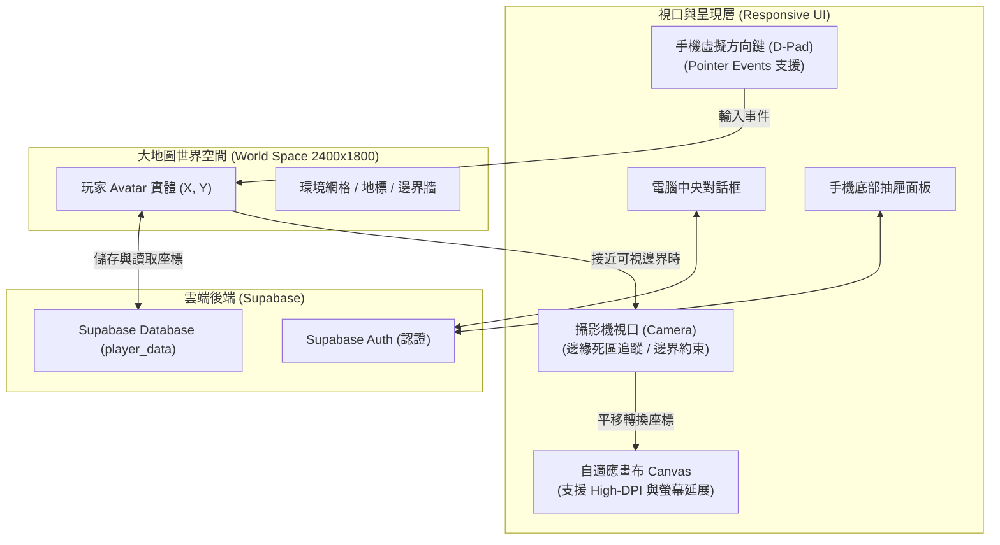

# 🎮 AI Game Project - 2D 畫布遊戲與雲端帳號同步系統

本專案是一個輕量、模組化且高度可維護的 HTML5 Canvas 2D 冒險遊戲系統。前端採用純原生 JavaScript (Vanilla JS) 與 CSS 變數設計系統，全響應式支援電腦與手機網頁；後端整合 **Supabase** 提供安全的帳號認證（Auth）與即時雲端進度同步（Database Upsert）。

---

## 🌟 核心功能特色

### 1. 📱 全響應式電腦與手機兼容
- **避免手機畫面變太小**：畫布採用動態自適應機制（Responsive Canvas），在手機直立或橫向螢幕上自動延展適配，告別以往固定 800x600 縮小在手機上導致字體或角色微縮難辨的問題。
- **雙套獨立彈窗顯示樣式 (Desktop vs Mobile Modal)**：
  - **電腦端 (Desktop)**：優雅的中央浮動卡片面板，具備立體陰影與精緻縮放動畫。
  - **手機端 (Mobile Bottom-Sheet)**：自動切換為現代行動 App 常見的**底部抽屜式面板**，配備頂部把手指示條（Drawer Handle）、大尺寸觸控目標與 16px 字體（避免 iOS Safari 點擊聚焦時畫面無故縮放）。
- **手機虛擬控制方向鍵 (Touch D-Pad)**：在手機或觸控設備上自動啟動半透明虛擬方向鍵，亦支援直接在畫布上滑動拖曳指引角色前進，無縫兼容觸控與鍵盤。

### 2. 🗺️ 大地圖座標系與攝影機邊緣死區追蹤 (`game.js`)
- **世界座標系維持一致**：大地圖設定為 `2400 × 1800`（或可自訂擴展），所有角色座標與資料庫儲存點皆以世界座標（World Space）為準。
- **以玩家為中心，邊緣死區觸發捲動 (Camera Deadzone)**：
  - 玩家在畫面中央範圍移動時，攝影機保持靜止，視野更穩定流暢。
  - 當玩家移動接近螢幕顯示邊緣（約 28% 死區邊界）時，攝影機平滑跟隨推進地圖範圍。
  - 攝影機具備世界邊界鎖定，絕不穿幫移出大地圖外。
- **豐富的世界環境視覺**：具備大地圖網格背景、起始營地廣場地標（400, 300）、綠意密林、水晶湖探索區以及世界外圍邊界警示邊框。
- **頂部座標 HUD 儀表板**：即時回饋目前玩家所在的世界 X、Y 座標。

### 3. 🔐 靈活的帳號認證系統 (`auth.js`)
- **任意字元遊戲暱稱支援**：Supabase Auth 原生需要標準 Email 格式；本系統透過 **UTF-8 Hex 編碼機制**，將包含中文、特殊英數的暱稱轉換為合法的虛擬郵件地址（例如：`[hex]@game.local`），免去使用者記憶複雜 Email 的負擔。
- **防重複點擊機制**：所有非同步操作均設有按鈕禁用（`disabled`）與載入中狀態回饋，防範網路延遲下的重複發送與競態條件。
- **身分驗證與密碼修改**：提供彈窗介面進行在線變更密碼，支援當前舊密碼重新鑑別以確保安全性。
- **中文友善錯誤轉譯**：將 Supabase 原生英文錯誤碼（如 `invalid login credentials`、`already registered`）在地化轉譯為易讀提示。

### 4. 💾 雲端進度與設定同步系統 (`save.js`)
- **單筆記錄 Upsert 機制**：角色世界座標（`pos_x`、`pos_y`）與個人偏好設定自動覆蓋或新增，確保資料庫維持高效率。
- **自訂自動存檔間隔**：玩家可在設定中自由選擇每 5 秒、10 秒、30 秒、60 秒或關閉自動存檔；偏好設定即時同步至雲端，下次登入自動生效。
- **手動存檔與登出保護**：提供頂部手動存檔按鈕，並在使用者登出前自動執行最後一次強制存檔（`forceSavePlayer`）。
- **雙態狀態浮動字卡 (Toast)**：提供優雅的動畫提示卡，支援成功（綠）與例外失敗（紅）之視覺反饋。

---

## 📁 專案目錄結構

```text
ai-game-project/
├── index.html                  # 專案首頁導覽入口 (自動導向遊戲主畫面)
├── README.md                   # 專案完整維護與架構說明文件
├── .gitignore                  # Git 忽略清單
├── docs/                       # 文件與綱要配置目錄
│   └── database_schema.sql     # Supabase player_data 資料表 SQL 建立腳本
├── tests/                      # 核心應用程式實作
│   ├── MainScreen.html         # 遊戲主畫面與視窗介面 (HTML)
│   ├── style.css               # 整合性 CSS 樣式表 (支援雙套彈窗與行動響應式)
│   ├── game.js                 # 遊戲引擎 (大地圖、攝影機死區追蹤、虛擬搖桿)
│   ├── auth.js                 # 帳號認證 (Supabase Auth、密碼變更、彈窗)
│   ├── save.js                 # 存檔同步 (雲端 Upsert、自動排程、Toast)
│   ├── amiya.jpg               # 角色展示圖檔
│   └── index.html              # 既有之「銀髮族防詐騙 AI 互動樂園」原型
└── frontend/                   # 預留之前端擴充目錄
```

---

## 🏛️ 模組架構與攝影機視口系統 (Architecture)



---

## 🗄️ Supabase 資料庫設定指引

在 Supabase 控制台的 **SQL Editor** 中執行 [`docs/database_schema.sql`](file:///c:/Users/user/Desktop/ai-game-project/docs/database_schema.sql)：

```sql
CREATE TABLE IF NOT EXISTS public.player_data (
    id UUID PRIMARY KEY REFERENCES auth.users(id) ON DELETE CASCADE,
    pos_x NUMERIC DEFAULT 400 NOT NULL,
    pos_y NUMERIC DEFAULT 300 NOT NULL,
    autosave_interval INTEGER DEFAULT 5000 NOT NULL,
    updated_at TIMESTAMP WITH TIME ZONE DEFAULT timezone('utc'::text, now()) NOT NULL
);

ALTER TABLE public.player_data ENABLE ROW LEVEL SECURITY;

CREATE POLICY "允許玩家查詢自身存檔" ON public.player_data
    FOR SELECT TO authenticated USING (auth.uid() = id);

CREATE POLICY "允許玩家新增自身存檔" ON public.player_data
    FOR INSERT TO authenticated WITH CHECK (auth.uid() = id);

CREATE POLICY "允許玩家更新自身存檔" ON public.player_data
    FOR UPDATE TO authenticated USING (auth.uid() = id) WITH CHECK (auth.uid() = id);
```

---

## 🚀 快速啟動方式

1. **直接開啟**：
   - 使用電腦或手機瀏覽器開啟根目錄下的 `index.html` 或 `tests/MainScreen.html` 即可直接暢玩。
2. **透過本地伺服器測試手機效果**：
   - 若在本地開發並想使用手機預覽，可使用 Python 啟動伺服器：
     ```bash
     python -m http.server 8000
     ```
   - 在電腦瀏覽器按 `F12` 切換為行動裝置模擬模式（如 iPhone 14 Pro, Pixel 7），即可直接體驗手機底部抽屜彈窗與虛擬方向鍵！
