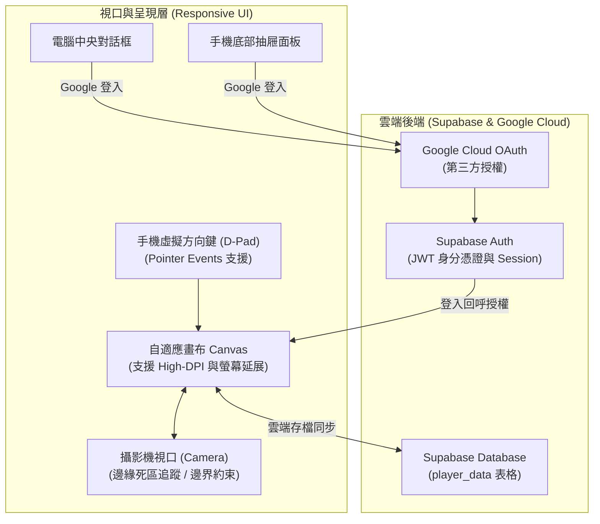

# 🎮 AI Game Project - 2D 畫布遊戲與雲端帳號同步系統

本專案是一個輕量、模組化且高度可維護的 HTML5 Canvas 2D 冒險遊戲系統。前端採用純原生 JavaScript (Vanilla JS) 與 CSS 變數設計系統，全響應式支援電腦與手機網頁；後端整合 **Supabase** 提供安全的帳號認證（支援一般帳號密碼與 **Google 第三方快速登入**）與即時雲端進度同步（Database Upsert）。

---

## 🌟 核心功能特色

### 1. 🌐 Google 第三方 OAuth 快速登入 (`auth.js`)
- **一鍵 Google 授權登入**：整合 Google Cloud Console 與 Supabase OAuth，彈窗內建專屬 Google 登入按鈕，點擊即可無縫跳轉並快速完成身分驗證。
- **第三方資料同步與動態頭像**：登入後自動帶入使用者的 Google 暱稱；若帳號含有個人頭像，遊戲角色外觀會自動切換為使用者本人的 Google 頭像（登出後復原）。
- **帳號身分智能識別**：設定視窗能自動辨識「Google 認證帳號」或「自訂遊戲帳號」；對 Google 用戶貼心提示免密碼維護說明，避免與密碼變更邏輯衝突。

### 2. 📱 全響應式電腦與手機兼容
- **避免手機畫面變太小**：畫布採用動態自適應機制（Responsive Canvas），在手機直立或橫向螢幕上自動延展適配，告別以往固定 800x600 縮小在手機上導致字體或角色微縮難辨的問題。
- **雙套獨立彈窗顯示樣式 (Desktop vs Mobile Modal)**：
  - **電腦端 (Desktop)**：優雅的中央浮動卡片面板，具備立體陰影與精緻縮放動畫。
  - **手機端 (Mobile Bottom-Sheet)**：自動切換為行動 App 經典的**底部抽屜式面板**，配備頂部把手指示條（Drawer Handle）、大尺寸觸控目標與 16px 字體（避免 iOS Safari 點擊聚焦時畫面無故縮放）。
- **手機虛擬控制方向鍵 (Touch D-Pad)**：在手機或觸控設備上自動啟動半透明虛擬方向鍵，亦支援直接在畫布上滑動拖曳指引角色前進，無縫兼容觸控與鍵盤。

### 3. 🗺️ 大地圖座標系與攝影機邊緣死區追蹤 (`game.js`)
- **世界座標系維持一致**：大地圖設定為 `2400 × 1800`，所有角色座標與資料庫儲存點皆以世界座標（World Space）為準。
- **以玩家為中心，邊緣死區觸發捲動 (Camera Deadzone)**：
  - 玩家在畫面中央範圍移動時，攝影機保持靜止，視野更穩定流暢。
  - 當玩家移動接近螢幕顯示邊緣（約 28% 死區邊界）時，攝影機平滑跟隨推進地圖範圍。
  - 攝影機具備世界邊界鎖定，絕不穿幫移出大地圖外。
- **豐富的世界環境視覺**：具備大地圖網格背景、起始營地廣場地標（400, 300）、綠意密林、水晶湖探索區以及世界外圍邊界警示邊框。
- **頂部座標 HUD 儀表板**：即時回饋目前玩家所在的世界 X、Y 座標。

### 4. 💾 雲端進度與設定同步系統 (`save.js`)
- **單筆記錄 Upsert 機制**：角色世界座標（`pos_x`、`pos_y`）與個人偏好設定自動覆蓋或新增，確保資料庫維持高效率。
- **自訂自動存檔間隔**：玩家可在設定中自由選擇每 5 秒、10 秒、30 秒、60 秒或關閉自動存檔；偏好設定即時同步至雲端，下次登入自動生效。
- **手動存檔與登出保護**：提供頂部手動存檔按鈕，並在使用者登出前自動執行最後一次強制存檔（`forceSavePlayer`）。
- **雙態狀態浮動字卡 (Toast)**：提供優雅的動畫提示卡，支援成功（綠）與例外失敗（紅）之視覺反饋。

---

## 📁 專案目錄結構

```text
ai-game-project/
├── index.html                  # 專案首頁導覽入口 (自動導向遊戲主畫面)
├── README.md                   # 專案完整維護與架構說明文件
├── .gitignore                  # Git 忽略清單
├── docs/                       # 文件與綱要配置目錄
│   └── database_schema.sql     # Supabase player_data 資料表 SQL 建立腳本
├── tests/                      # 核心應用程式實作
│   ├── MainScreen.html         # 遊戲主畫面與視窗介面 (HTML)
│   ├── style.css               # 整合性 CSS 樣式表 (支援雙套彈窗與行動響應式)
│   ├── game.js                 # 遊戲引擎 (大地圖、攝影機死區追蹤、虛擬搖桿)
│   ├── auth.js                 # 帳號認證 (Google OAuth、Supabase Auth、密碼變更)
│   ├── save.js                 # 存檔同步 (雲端 Upsert、自動排程、Toast)
│   ├── amiya.jpg               # 角色展示圖檔
│   └── index.html              # 既有之「銀髮族防詐騙 AI 互動樂園」原型
└── frontend/                   # 預留之前端擴充目錄
```

---

## 🏛️ 模組架構與資料流 (Architecture)



---

## 🚀 快速啟動與 Google 登入測試注意

> [!IMPORTANT]
> Google OAuth 要求回呼網址（Redirect URI）必須為有效的 HTTP 或 HTTPS 協議（例如 `http://localhost:8000` 或 `http://127.0.0.1:5500`），**不支援直接雙擊開啟的 `file:///` 本地路徑**。

若要測試 Google 登入：
1. **使用本地 HTTP 伺服器啟動**：
   ```bash
   # 在專案目錄執行 Python 內建伺服器
   python -m http.server 8000
   ```
   或使用 VS Code 安裝 **Live Server** 套件啟動。
2. 瀏覽器開啟 `http://localhost:8000/tests/MainScreen.html`。
3. 點擊右上角「登入 / 註冊」打開彈窗，點擊「**使用 Google 帳號快速登入**」，即可順暢授權並回跳至遊戲！
